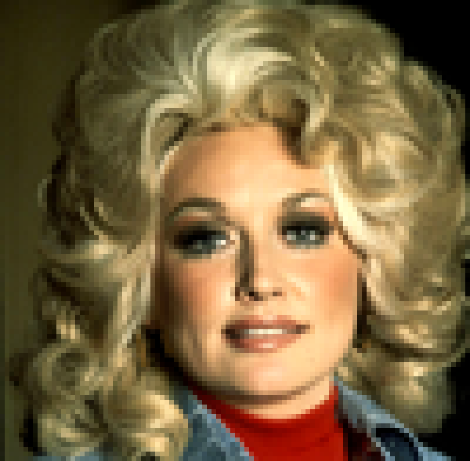

# dolly-ascii

Dolly Parton in your terminal.



*Color output of `dolly.sh` on a truecolor terminal (rendered from the script's own color data).*

## Running it

```bash
git clone https://github.com/cbmeeks/Dolly.git
cd Dolly

./dolly.sh               # photo-based portrait (full color on a truecolor terminal)
./dolly.sh --ascii       # force plain ASCII shading
./dolly-handdrawn.sh     # hand-drawn ASCII version
```

If a script isn't executable, run it with `bash dolly.sh` instead.

**Requirements:** `bash`, `base64` and `gzip` (standard on Linux and macOS). For the
best result use a truecolor terminal (e.g. kitty, iTerm2, GNOME Terminal, Windows
Terminal) at least 100 columns wide and 50 rows tall; a narrower window will wrap the
image. Color is skipped automatically when output is piped or `NO_COLOR` is set.

## What's inside

- `dolly.sh` renders a photo-based portrait. On a truecolor terminal it draws full-color
  half-block graphics; when piped, with `NO_COLOR` set, or with `--ascii`, it prints
  plain ASCII shading.
- `dolly-handdrawn.sh` is a hand-drawn ASCII version (tinted blonde/red on a color terminal).
- `tools/gen.py` regenerates `dolly.sh` from a source image (needs Python + Pillow):
  `python3 tools/gen.py photo.png dolly.sh`

The source photograph is not included in this repository.
